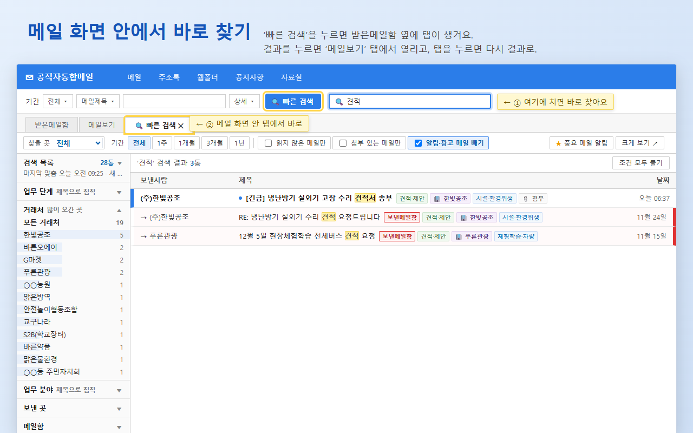

# 공직자통합메일도우미(학교)

학교 행정실 직원을 위해 만든 공직자통합메일(korea.kr) 크롬 확장프로그램입니다. (비공식)

행정실에는 업체와 주고받는 견적서·계약 서류·거래명세서·세금계산서·완납증명서 메일이 하루에도 수십 통씩 쌓입니다.
이 도우미는 새 메일을 놓치지 않게 알려 주고, 지난 메일을 업체별·업무 단계별로 빨리 찾게 해 줍니다.
선생님 등 다른 교직원도 쓸 수 있습니다.

> 행정안전부 또는 공직자통합메일 운영 기관이 만든 공식 프로그램이 아닙니다.
> 업무용 PC에 설치하기 전에 학교(기관) 정보보안 담당자에게 확인하세요.

- 📄 설명 페이지: https://hessedtov.github.io/korea-mail-notifier/
- ▶️ 소개 동영상: https://www.youtube.com/watch?v=K6is-JRe3_g
- 📦 내려받기: [download/mail-helper-school-1.0.0.zip](download/mail-helper-school-1.0.0.zip) (크롬 웹 스토어 등록 심사 중)

## 설치하기 (파일로)
1. 내려받은 압축 파일을 풀어, 지워지지 않을 곳(예: 문서 폴더)에 둡니다.
2. 크롬 주소창에 `chrome://extensions` 를 입력합니다.
3. 오른쪽 위 **개발자 모드**를 켭니다.
4. **압축해제된 확장 프로그램을 로드합니다**를 눌러 1번의 폴더를 고릅니다.
5. 크롬 오른쪽 위 퍼즐 모양 아이콘 → 이 확장프로그램 옆 핀을 눌러 고정합니다.

파일로 설치하면 저절로 업데이트되지 않습니다. 스토어 등록이 끝나면 스토어 버전으로 바꾸는 것을 권합니다.

## 주요 기능

### 새 메일 알림
- 새 메일이 오면 화면 오른쪽 아래에 알림 창이 올라옵니다. 보낸 사람과 제목이 보이고, '닫기'를 눌러야 닫혀서 놓치지 않습니다.
- 메일 탭을 닫아 두어도 알려 줍니다. (크롬만 켜져 있으면 됨)
- 크롬 툴바 아이콘에 안 읽은 메일 수가 표시되고, 로그인이 풀리면 알려 줍니다.
- 정해 둔 낱말(예: 긴급, 제출)이나 사람·기관이 보낸 메일은 ⭐와 노란색으로 눈에 띄게 알려 줍니다.
- 로그인 자동 연장: 화면의 '이용 연장하기'와 같은 요청을 10분마다 보내 로그인을 유지합니다. 기관 지침상 안 되면 끌 수 있습니다.

### 메일 화면 안 '빠른 검색'
- 공직자통합메일 검색창 오른쪽에 파란 테두리 '🔍 빠른 검색' 칸이 생깁니다. 치는 대로 받은메일함 옆 '빠른 검색' 탭에서 바로 찾습니다.
- 결과를 누르면 메일 화면의 '메일보기' 탭에서 열리고, '빠른 검색' 탭을 누르면 찾던 결과로 돌아옵니다.
- 띄어쓰기를 몰라도 찾습니다. ("세금 계산서" → "전자세금계산서")
- 초성으로 찾습니다. ("ㄱㅅㅅ" → 계산서·세금계산서, "ㄱㅈㅅ" → 견적서)
- 비슷한 말도 함께 찾습니다. ("밥" → 급식, "고장" → 수리·보수)
- 메일본문·첨부이름은 공직자통합메일 화면 검색으로 넘겨, 낱말과 기간을 넣고 검색까지 대신 눌러 줍니다.

### 행정실 업무에 맞춘 분류
- **거래처별 모아 보기:** 업체 이름을 누르면 그 업체와 오간 견적·서류·계산서를 한꺼번에 봅니다. 세금계산서 알림 메일도 제목 속 실제 업체 이름으로 묶습니다.
- **업무 단계:** 견적·제안 → 계약 서류 → 주문·배송 → 이행·검수 서류 → 세금계산서·증빙 → 청구·요금
- **업무 분야:** 계약·지출(견적서·거래명세서·세금계산서·완납증명서·4대보험 서류·대금 청구), 시설·환경위생, 급식, 보건, 체험학습·차량, 방과후·늘봄 등
- **보낸 곳:** 거래 업체, 쇼핑몰, 학교장터·조달, 공공기관, 교육청·학교 등
- 쇼핑몰 주문·배송 알림과 광고는 처음엔 빼고 보여 줘서 업무 메일이 바로 보입니다.
- 같은 제목(RE:/FW:)끼리 묶고, 받은 메일은 파란 띠·보낸 메일은 빨간 띠로 구분합니다.

## 메일 서버에 부담을 주지 않도록
- 요청은 한 번에 하나씩, 1.5초 넘게 쉬어 가며 1분에 20번을 넘기지 않습니다.
- 처음 한 번만 목록을 모으고, 그 뒤에는 새 메일 확인 때 받은 목록만 더합니다. 전체 맞춤은 하루 한 번까지입니다.
- 검색은 PC에 모아 둔 목록에서만 하므로 서버에 요청하지 않습니다.

## 개인정보
- 메일 제목·보낸 사람·날짜 목록만 이 PC의 크롬 안에 저장하고, 어디로도 보내지 않습니다.
- 메일 본문과 첨부파일은 가져오지 않으며, 메일을 옮기거나 지우거나 읽음으로 바꾸는 요청을 보내지 않습니다.
- 개발자 서버가 없고, 분석·광고 도구를 쓰지 않습니다.
- 자세한 내용: [개인정보처리방침](https://hessedtov.github.io/korea-mail-notifier/school/)
